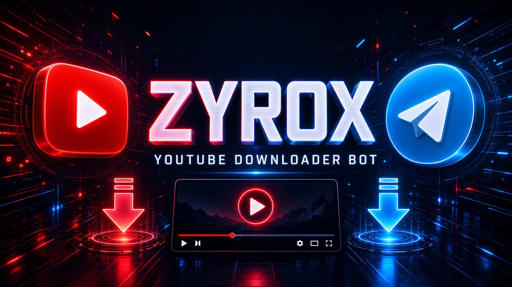

<div align="center">




<br/>

<a href="https://readme-typing-svg.demolab.com/demo/">
  
</a>

<br/>


<br/><br/>

[](https://www.python.org/)
[](https://docs.pyrogram.org/)
[](https://github.com/yt-dlp/yt-dlp)
[](https://www.docker.com/)
[](https://render.com/)

<br/>

[](https://t.me/ZyroxV1)
[](https://t.me/ZyroxMod)

</div>

---

## 🔥 Features

| Feature | Details |
|---|---|
| 🎬 **Quality Options** | 360p • 720p • 1080p • Best • 🎵 Audio MP3 |
| 📊 **Live Progress Bar** | Download **aur** Upload — dono me bar + **% percentage**, speed, ETA, downloaded / total size |
| 🖼️ **Thumbnail** | Link bhejte hi thumbnail photo ke saath info, aur uploaded video/audio par bhi thumbnail attach hota hai |
| 📦 **Size Show** | Har quality button par estimated size (e.g. `💻 720p • 48.2 MB`), final caption me exact size |
| ⏱️ **Length Show** | Video duration (length), resolution, views, likes, channel name — sab info card me |
| 🔒 **Force Join** | Bot use karne se pehle **[@ZyroxV1](https://t.me/ZyroxV1)** + **[@ZyroxMod](https://t.me/ZyroxMod)** join karna compulsory |
| 🚀 **Large Files** | Pyrogram MTProto — 50MB Bot API limit nahi, badi files bhi direct |
| 🛠️ **Admin Panel** | Button-based: Stats, Broadcast, Users (Block/Unblock), Extra Force-Join Channels |
| 🛑 **Cancel Button** | Download / upload beech me rok sakte ho |
| 🌐 **1000+ Sites** | yt-dlp powered — YouTube ke alawa kai sites supported |

---

## 📱 Bot Kaisa Dikhta Hai? (Demo Flow)

**1️⃣ Link bhejo → Thumbnail + Size + Length ke saath info card:**

```text
🎬 Video Title Here

👤 Channel: Channel Name
⏱️ Length: 10:24 (624 sec)
🖥️ Resolution: 1920x1080
👁️ Views: 1.2M • ❤️ 45K
📦 Estimated Size:
📱 360p: 18.4 MB
💻 720p: 52.7 MB
🖥️ 1080p: 110.3 MB

Select quality:
[ 📱 360p • 18.4 MB ]  [ 💻 720p • 52.7 MB ]  [ 🎵 Audio • 9.5 MB ]
```

**2️⃣ Quality select karo → Live progress line + percentage:**

```text
⬇️ Downloading…
📌 Video Title Here
🎚️ 💻 720p

███████░░░░░░░░░░░ 42.5%
📦 22.4 MB / 52.7 MB
⚡ Speed: 3.2 MB/s • ⏳ ETA: 0:09
⏱️ Elapsed: 0:07
```

**3️⃣ Phir upload progress bhi live:**

```text
⬆️ Uploading…
████████████░░░░░░ 68.0%
📦 35.8 MB / 52.7 MB
⚡ Speed: 2.1 MB/s • ⏳ ETA: 0:08
```

**4️⃣ Final video — thumbnail ke saath, caption me sab details:**

```text
🎬 Video Title Here
🎚️ Quality: 💻 720p
📦 Size: 52.7 MB
⏱️ Length: 10:24 • 🖥️ 1280x720

📢 @ZyroxV1 • @ZyroxMod
```

---

## 🔒 Force Join Setup — @ZyroxV1 + @ZyroxMod

- Default channels code me set hain: `ZyroxV1,ZyroxMod` (env se change ho sakte hain — neeche dekho).
- User `/start` kare ya link bheje, pehle dono channels join karne ko bola jayega, phir **✅ I've Joined — Verify** button se re-check hoga.
- Owner (`OWNER_ID`) ke liye force-join bypass hai.

> ⚠️ **ZAROORI:** Apne bot ko **dono channels (@ZyroxV1 aur @ZyroxMod) me Admin/Member add karo**, warna Telegram bot ko membership check nahi karne dega aur verification sabke liye fail hoga.

Extra channels Admin Panel → 📢 Channels se bhi add ho sakte hain (numeric chat ID se).

---

## ⚙️ Environment Variables

| Variable | Required | Kahan se milega |
|---|---|---|
| `API_ID` | ✅ Yes | [my.telegram.org](https://my.telegram.org) |
| `API_HASH` | ✅ Yes | [my.telegram.org](https://my.telegram.org) |
| `BOT_TOKEN` | ✅ Yes | [@BotFather](https://t.me/BotFather) |
| `OWNER_ID` | ⭐ Recommended | Apna Telegram user ID ([@userinfobot](https://t.me/userinfobot)) — Admin Panel ke liye |
| `FORCE_JOIN` | Optional | `on` (default) / `off` |
| `FORCE_JOIN_CHANNELS` | Optional | Default: `ZyroxV1,ZyroxMod` |
| `PORT` | Optional | Platform deta hai (default `8000`) — health check ke liye |

`.env.example` file ko copy karke apni values bharo. **Tokens kabhi GitHub pe commit mat karo!**

---

## 🚀 Deploy

### ▶️ Option 1 — Render (Docker)

1. Is repo ko apne GitHub par rakho → [render.com](https://render.com) → **New → Web Service** → repo select karo.
2. Runtime: **Docker** (repo me `Dockerfile` + `render.yaml` ready hai).
3. Environment me `API_ID`, `API_HASH`, `BOT_TOKEN`, `OWNER_ID` add karo.
4. Deploy! Health check `$PORT` par `OK` reply karega, bot MTProto par chalega (webhook nahi chahiye).

### 🐳 Option 2 — Docker (VPS / Local)

```bash
git clone https://github.com/zyroxteam/youtube-downloader-bot.git
cd youtube-downloader-bot

docker build -t zyrox-ytdl-bot .
docker run -d --name zyrox-bot --restart unless-stopped \
  -e API_ID=12345678 \
  -e API_HASH=xxxxxxxxxxxxxxxx \
  -e BOT_TOKEN=123456:ABC-xxxx \
  -e OWNER_ID=123456789 \
  -e FORCE_JOIN_CHANNELS="ZyroxV1,ZyroxMod" \
  -p 8000:8000 \
  zyrox-ytdl-bot
```

### 💻 Option 3 — Local / VPS (Python)

```bash
# ffmpeg zaroori hai (video+audio merge ke liye)
sudo apt install -y ffmpeg python3 python3-pip

git clone https://github.com/zyroxteam/youtube-downloader-bot.git
cd youtube-downloader-bot
pip install -r requirements.txt

export API_ID=12345678
export API_HASH=xxxxxxxxxxxxxxxx
export BOT_TOKEN=123456:ABC-xxxx
export OWNER_ID=123456789

python bot.py
```

---

## 🤖 Commands

| Command / Button | Kaam |
|---|---|
| `/start` | Welcome + Force-Join check |
| `/help` | Help menu |
| `/cancel` ya 🛑 button | Running download cancel |
| `/ping` | Owner only — bot alive hai ya nahi |
| 🛠️ **Admin Panel** (owner) | 📊 Stats • 📣 Broadcast • 👥 Users • 📢 Channels |

Baaki sab kuch **buttons** se hota hai — commands yaad rakhne ki zaroorat nahi! 😎

---

## 📂 Project Structure

```text
youtube-downloader-bot/
├── bot.py                 # 🤖 Main bot (Pyrogram + yt-dlp)
├── requirements.txt       # 📦 Python dependencies
├── Dockerfile             # 🐳 Docker image (ffmpeg included)
├── Procfile               # Procfile platforms ke liye
├── render.yaml            # ☁️ Render one-click config
├── .env.example           # 🔐 Env vars template (secrets nahi!)
└── assets/
    ├── banner.jpg         # 🖼️ README banner
    └── running-text.svg   # ✨ Animated running text
```

---

## 🛠️ Tech Stack

- **Pyrogram** (MTProto) — badi files, koi 50MB limit nahi
- **yt-dlp** — download engine (Android client se 403 bypass)
- **ffmpeg** — video+audio merge, MP3 extract
- **SQLite** — users / stats / channels / settings
- **Docker-ready** — Render, Railway, VPS, kahin bhi chalega

---

<div align="center">

## 📢 Support & Updates

[](https://t.me/ZyroxV1)
[](https://t.me/ZyroxMod)

⭐ **Repo pasand aaya to Star karna mat bhoolna!** ⭐

</div>

> ⚠️ **Disclaimer:** Yeh project sirf educational purpose ke liye hai. Sirf wahi content download karo jiska tumhare paas haq hai ya jo copyright-free / Creative Commons hai. YouTube Terms of Service aur copyright laws ka respect karo.

<div align="center">

</div>
